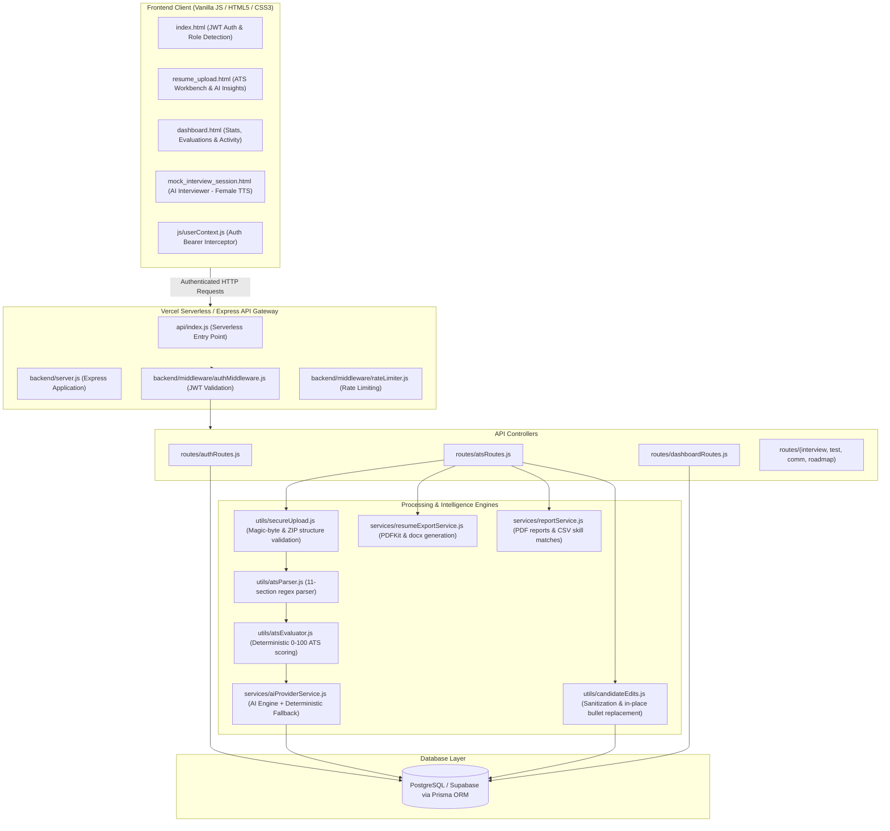

# ASCEND — Complete Project Documentation & Technical Architecture

---

## 1. Executive Summary

**ASCEND** is an AI-powered Career Preparation and Resume Intelligence Platform built to prepare job seekers and students for modern recruitment and technical hiring pipelines.

Modern recruitment uses automated Applicant Tracking Systems (ATS) to screen, rank, and eliminate candidate applications before human recruiters review them. ASCEND provides candidate-centric intelligence to diagnose resume weaknesses, optimize bullet points according to the STAR methodology, match candidates against job descriptions (JDs), evaluate skills through automated technical tests and speech-enabled AI mock interviews, and export high-conversion resume formats.

---

## 2. System Architecture & Workflow



---

## 3. Core Features Breakdown

### 3.1. Resume Upload Validation
- **Binary Signature (Magic-Byte) Checks**: Inspects `%PDF-` file headers for PDF uploads and `0x04034b50` ZIP structure headers for DOCX files to prevent file-extension spoofing.
- **DOCX Package Inspection**: Validates internal XML structure (`[Content_Types].xml` and `word/document.xml`) to prevent corrupted packages from crashing parsers.
- **Size & Non-Zero Byte Verification**: Enforces a strict 5 MiB ceiling and blocks 0-byte files with immediate 400 Bad Request responses.
- **Client-Side Drag-and-Drop UX**: Pre-validates file extension and size in the browser before network transmission.

### 3.2. Resume Parsing Across 11 Sections
Extracts and tokenizes text into 11 discrete candidate sections:
1. `Name`
2. `Email`
3. `Phone`
4. `Summary`
5. `Skills`
6. `Tools`
7. `Education`
8. `Experience`
9. `Projects`
10. `Certifications`
11. `Achievements`

### 3.3. Deterministic ATS Scoring
Calculates a transparent score (0–100) based on:
- Contact information completeness (Name, verified Email format, valid Phone).
- Core section presence (Experience, Education, Skills).
- Action-verb strength and quantifiable metrics in bullet points.
- Keyword relevance tailored to the selected target job role.

### 3.4. AI Resume Diagnosis & Explanations
Generates grounded feedback with four key categories:
- **Strengths**: What the candidate did well.
- **Weaknesses**: Missing elements or poor formatting.
- **Missing Information**: Critical sections or contact details omitted.
- **Actionable Suggestions**: Specific guidance accompanied by a clear *"Why this matters"* explanation.
- *Zero-Hallucination Fallback*: If external AI services are disabled or offline, a deterministic rule-based engine generates grounded feedback based on parser heuristics.

### 3.5. Job Description (JD) Analysis & Matching
- Accepts pasted JD text or uploaded PDF/DOCX/TXT files.
- Extracts job title, required skills, preferred qualifications, experience requirements, and responsibilities.
- Calculates an explainable match score:
  - Required skills overlap (50 points).
  - Experience relevance (25 points).
  - Education requirements (15 points).
  - Structural completeness (10 points).
- Renders green chips for matching skills, red chips for missing skill gaps, and statutory legal guidance disclaimers.

### 3.6. Interactive Resume Improvements (STAR Rewrites)
- Produces optimized summaries and STAR-format bullet rewrites (Situation, Task, Action, Result).
- Provides side-by-side comparison cards with **Accept** and **Reject** buttons.
- On Accept: cleanly replaces the targeted bullet in-place within experience/projects and updates the database tracking status.

### 3.7. Resume Export Across 3 Templates
Exports candidate data into formatted, ATS-compliant documents:
- **Modern Clean**: Contemporary layout with clear headers and optimal spacing.
- **Executive Classic**: Traditional, structured serif format for corporate roles.
- **Tech Minimal**: Compact, high-density format tailored for software engineering.
- Supported output formats: **PDF** (via PDFKit) and **DOCX** (via `docx`).

### 3.8. AI Mock Interviewer with Natural Female Voice
- Integrated interactive mock interview simulation with real-time speech recognition and text-to-speech.
- Automatically selects high-quality female voices (`Microsoft Zira`, `Microsoft Jenny`, `Google US English Female`, `Samantha`, `Victoria`, `Karen`) with natural speech cadence (0.98x rate, 1.15 pitch).
- Evaluates candidate answers in real-time, checking keyword coverage and communication clarity.

### 3.9. Centralized Candidate Dashboard
- Summarizes overall career readiness across Resume, Technical, Communication, Mock Interview, and Roadmap modules.
- Lists recent resumes with direct deep links (`?resumeId=...`) that automatically load the resume workbench state.
- Lists job matches and generated resume files with direct download links.

---

## 4. Technical File-by-File Mapping

| Feature | Primary Files | Details |
|---|---|---|
| **Server & Middleware** | `backend/server.js`<br>`backend/middleware/authMiddleware.js`<br>`backend/middleware/rateLimiter.js` | Express app, CORS, Helmet, JWT auth validation, rate limiting, and Vercel serverless export. |
| **Resume Upload & Validation** | `backend/routes/atsRoutes.js`<br>`backend/utils/secureUpload.js`<br>`frontend/resume_upload.html` | Magic-byte checks, Multer error trapping, 5MB limit, drag-and-drop client validation. |
| **Parsing & ATS Evaluation** | `backend/utils/atsParser.js`<br>`backend/utils/atsEvaluator.js`<br>`backend/utils/keywordEvaluator.js` | 11-section regex parsing, tokenization, deterministic weighted ATS scoring. |
| **AI Diagnosis & Suggestions** | `backend/services/aiProviderService.js`<br>`backend/services/geminiService.js` | LLM analysis with deterministic fallback, structured JSON output, "why" explanations. |
| **JD Matching & Gap Analysis** | `backend/routes/atsRoutes.js`<br>`backend/utils/jobMatchEvaluator.js` | JD text/file extraction, skill overlap matching, gap identification, score breakdown. |
| **Candidate Edits & Rewrites** | `backend/utils/candidateEdits.js`<br>`backend/routes/atsRoutes.js` | Input sanitization, ownership verification, in-place bullet replacement, versioning. |
| **Template Generation (PDF/DOCX)** | `backend/services/resumeExportService.js`<br>`backend/routes/atsRoutes.js` | PDFKit and `docx` generation across Modern Clean, Executive Classic, and Tech Minimal. |
| **Diagnostic Reports** | `backend/services/reportService.js` | PDF analysis reports with breakdown charts, CSV skill match summaries. |
| **Mock Interview (Female TTS)** | `frontend/mock_interview_session.html`<br>`backend/routes/interviewRoutes.js` | SpeechSynthesis female voice selection, SpeechRecognition, answer scoring. |
| **Dashboard Integration** | `backend/routes/dashboardRoutes.js`<br>`backend/services/dashboardService.js`<br>`frontend/dashboard.html` | Multi-module readiness calculation, resume review deep-linking, download links. |
| **Authentication & User Context** | `backend/routes/authRoutes.js`<br>`frontend/index.html`<br>`frontend/js/userContext.js` | Bcrypt password hashing, JWT creation/verification, Bearer token injection. |
| **Database Schema** | `backend/prisma/schema.prisma` | PostgreSQL schema defining `User`, `CandidateResume`, `JobDescription`, `JobMatch`, `ParsedResumeVersion`, `ImprovementSuggestion`. |
| **Automated Test Suite** | `backend/tests/run_tests.js`<br>`backend/tests/*.test.js` | 9 automated test suites verifying parser, evaluator, AI fallback, auth, security, upload, and export. |

---

## 5. Before vs. After: Technical Improvements & Rationale

| Area | Previous State (Before) | Current State (After) | Why We Changed It |
|---|---|---|---|
| **Upload Validation** | Multer disk storage; files >5MB threw uncaught errors causing generic 500 server crashes. No binary validation. | Custom `handleResumeUpload` catching `LIMIT_FILE_SIZE` as a clean 400 Bad Request; binary `%PDF-` and ZIP signature checks; client-side size check. | Prevents corrupted files or disguised executables from being processed, providing clear error feedback to users. |
| **Security & Auth Tests** | `auth.test.js` failed with `secretOrPrivateKey must have a value` because `JWT_SECRET` wasn't exported. | Exported `getJwtSecret`, unified secret resolution across middleware and test runners. | Fixed test runner failure and ensured JWT authentication is strictly verified on all candidate endpoints. |
| **Download Security** | Files in uploads directory were served without checking candidate ownership. | `GET /api/ats/download/:filename` checks user authentication, candidate role, filename sanitization, and database ownership. | Protects candidate privacy and prevents unauthorized access to resumes and reports. |
| **Candidate Updates** | `sanitizeCandidateUpdate` was imported but unused; no ownership check on edit route. | Fully integrated `sanitizeCandidateUpdate` sanitizing all 11 fields, verifying email/phone, and validating resume ownership. | Eliminates cross-user modification vulnerabilities and prevents malformed data from corrupting records. |
| **STAR Bullet Improvements** | Accepting a bullet rewrite appended the bullet to the end of the section text. | Implemented `replaceBullet()` to replace the target bullet in-place; persists `ACCEPTED`/`REJECTED` in `ImprovementSuggestion`. | Preserves professional resume structure and formatting without duplications. |
| **Dashboard Navigation** | Clicking "Review" navigated to `resume_upload.html` without state. | Appended `?resumeId=${r.id}` and implemented `loadExistingResume()` to hydrate the candidate form, score, and AI tabs. | Streamlines workflow by letting candidates jump straight into reviewing an existing resume. |
| **Mock Interview Voice** | Default browser text-to-speech voice (often robotic or male depending on OS defaults). | Intelligent female voice selection (`Microsoft Zira`, `Jenny`, `Samantha`, etc.) with calibrated pitch (1.15) and rate (0.98). | Provides a natural, professional, and pleasant mock interview experience. |
| **Cloud Serverless Deployment** | App only ran locally via Express `app.listen()`. | Created `api/index.js` serverless entry, `vercel.json` routing, protected `fs.mkdirSync` for read-only environments, and configured root `package.json`. | Enables automated production deployment on Vercel while maintaining local development capabilities. |

---

## 6. How to Run, Test, and Deploy

### Local Development
```bash
# Navigate to backend directory
cd backend

# Install dependencies and generate Prisma client
npm install
npx prisma generate

# Run the backend server
node server.js
```
The application will be accessible at `http://localhost:3002`.

### Running Automated Tests
```bash
cd backend
npm test
```
Executes all 9 automated test suites:
1. ATS Parser Suite
2. ATS Evaluator Suite
3. AI Provider & Grounding Suite
4. Authentication & Security Suite
5. Secure Upload Validation Suite
6. Upload Boundary & Signature Validation Suite
7. Explainable JD Match Suite
8. Safe Route Logging Suite
9. Resume Export (PDF & DOCX) Suite

### Production Deployments
- **GitHub Repository**: [https://github.com/yaswanth-tech/AI-RESUME-AUTOMATION](https://github.com/yaswanth-tech/AI-RESUME-AUTOMATION)
- **Live Vercel Application**: [https://ascend-nine-lilac.vercel.app](https://ascend-nine-lilac.vercel.app)
